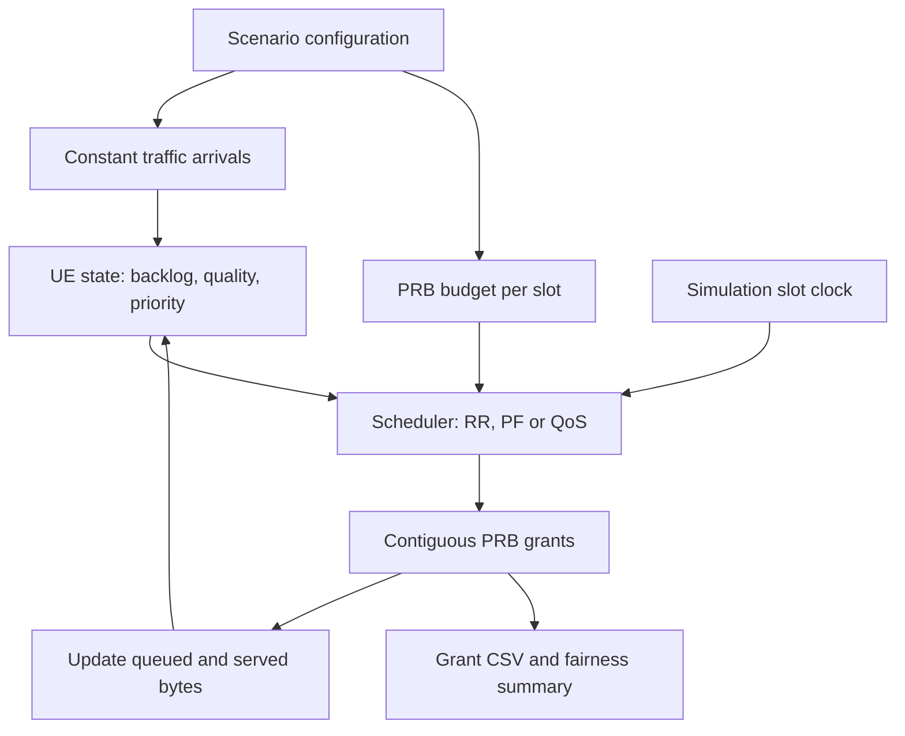

# AETHER-5G

### A C++20 simulation platform for exploring 5G radio resource scheduling.


**How does a base station decide which user gets radio resources when everyone has data to send?**

AETHER-5G makes that decision visible. It simulates users competing for limited resources, applies different scheduling policies, and verifies that every allocation respects resource and byte-accounting constraints.

> **Current scope:** A deterministic, single-threaded MAC scheduling foundation. The broader Layer 2 platform is under development. This is not a complete NR MAC, an interoperable base station, or a certified implementation.

[Quick Start](#quick-start) · [Architecture](#architecture) · [Scheduling Example](#scheduling-example) · [Tests](#verification) · [Roadmap](#roadmap)

---

## What can you do with it?

- Simulate multiple users with queued downlink traffic.
- Allocate physical resource blocks within a slot budget.
- Compare round-robin, proportional-fair, and priority-first scheduling.
- Configure channel quality, priority, and active state through the C++ API.
- Inspect deterministic scheduling grants.
- Measure fairness and scheduler execution latency.
- Run automated regression and randomized invariant tests.

## Key concepts

| Concept | Meaning |
|---|---|
| **UE** | A simulated user equipment, such as a phone |
| **Slot** | One scheduling time step; the CLI uses 1 ms |
| **PRB** | Physical resource block, a unit of the simulated radio resource budget |
| **Backlog** | Bytes waiting in a user’s downlink queue |
| **Grant** | An allocation containing UE ID, starting PRB, PRB count, and scheduled bytes |
| **Channel quality** | A synthetic value from 0 to 15; 0 represents an outage |
| **Served bytes** | Bytes allocated by the scheduler, not confirmed radio delivery |

## Architecture

The diagram shows the implemented scheduling path.



The scheduler owns UE state. Stable ID ordering makes tie-breaking reproducible, while a shared allocation path maintains accounting across all policies.

**RLC, PDCP, SDAP, HARQ, and PHY transmission are planned extensions.**

## Scheduling policies

| Policy | CLI option | How it chooses users | Tradeoff |
|---|---|---|---|
| **Round-robin** | `rr` | Gives eligible users turns, starting after the last served UE | Equal turns do not necessarily mean equal byte throughput |
| **Proportional-fair** | `pf` | Compares estimated capacity with recent average service | Balances channel advantage and service history |
| **Priority-first QoS** | `qos` | Serves lower numeric priorities first, then uses PF ranking | Strict priority can starve lower-priority traffic |

The CLI uses equal channel quality and priority. Heterogeneous channels, outages, inactive users, and different priorities are exercised through the C++ API and tests.

The QoS policy is a custom inter-UE policy. It does not implement the 3GPP uplink logical-channel prioritization procedure.

## Quick start

### Prerequisites

- C++20 compiler
- CMake 3.20+
- Ninja
- Python 3

The recorded verification platform is Linux with GCC 14.2.0. Clang CI configuration is included; Clang and macOS builds have not been verified in this checkpoint.

### Build and test

From the repository root:

```bash
cmake -S . -B build -G Ninja -DCMAKE_BUILD_TYPE=Debug
cmake --build build -j 4
ctest --test-dir build --output-on-failure
```

GoogleTest 1.15.2 downloads during configuration with a pinned SHA-256 checksum.

For an offline build, add:

```bash
-DFETCHCONTENT_SOURCE_DIR_GOOGLETEST=/path/to/googletest
```

### Start a simulation

```bash
./build/aether_slots rr 10 100 50 500
```

| Argument | Value | Meaning |
|---|---:|---|
| Policy | `rr` | Round-robin scheduling |
| UEs | `10` | Simulated users |
| Slots | `100` | Scheduling steps |
| PRBs | `50` | Shared resource budget per slot |
| Bytes | `500` | New bytes added to each UE per slot |

### Save the output

```bash
./build/aether_slots rr 10 100 50 500 \
  > grants.csv \
  2> summary.json
```

- `grants.csv`: per-slot resource allocations.
- `summary.json`: final slot count and fairness.

## Scheduling example

Run three users competing for three PRBs:

```bash
./build/aether_slots rr 3 3 3 100
```

Each user receives **100 new queued bytes per slot**.

At the default channel quality of 7, three PRBs carry **97 bytes** under the approximate capacity model. Round-robin rotates the allocation:

| Slot | PRB 0 | PRB 1 | PRB 2 | Scheduled bytes |
|---|---|---|---|---:|
| 0 | UE 1 | UE 1 | UE 1 | 97 |
| 1 | UE 2 | UE 2 | UE 2 | 97 |
| 2 | UE 3 | UE 3 | UE 3 | 97 |

Expected output:

```csv
slot,ue,first_prb,prbs,bytes
0,1,0,3,97
1,2,0,3,97
2,3,0,3,97
```

Fairness summary:

```json
{"slots":3,"fairness":1}
```

All three users received equal service, so Jain’s fairness index is 1. Their queues still contain data.

**Perfect fairness does not mean all traffic demand was satisfied.**

## Reproducible scenarios

```bash
python3 tools/run_scenario.py \
  scenarios/saturation.json \
  ./build/aether_slots
```

| Scenario | UEs | Slots | PRBs per slot | Bytes per UE per slot | Purpose |
|---|---:|---:|---:|---:|---|
| [Idle](scenarios/idle.json) | 0 | 10 | 50 | 0 | Verify empty-network behavior |
| [Single user](scenarios/single.json) | 1 | 20 | 50 | 100 | Check basic service and accounting |
| [Balanced](scenarios/balanced.json) | 10 | 100 | 50 | 500 | Exercise competing users |
| [Saturation](scenarios/saturation.json) | 100 | 1,000 | 100 | 1,000 | Exercise demand beyond capacity |

These scenarios use constant arrivals and round-robin scheduling. The seed field is reserved for future stochastic workloads; current scenario execution does not use randomness.

## Resource accounting

The implementation and tests enforce these invariants:

- Allocated PRBs do not exceed the slot budget.
- Grants are contiguous and non-overlapping.
- A UE receives at most one grant per slot.
- Empty, inactive, and outage UEs receive no grants.
- Scheduled bytes do not exceed backlog or modeled capacity.
- Admitted bytes equal queued bytes plus served bytes for each registered UE.
- Identical reference executions produce identical grants.

Byte admission is checked for integer overflow. Removing a UE discards its state.

### Capacity model

```text
capacity_bytes =
    floor(PRBs × 144 × modulation_order × rate1024 / 8192)
```

The model assumes:

- 12 subcarriers and 12 data symbols per PRB.
- One spatial layer.
- Synthetic modulation order selection by quality range.
- `rate1024 = 128 + 48 × quality`.
- Zero capacity for quality 0.

**This is not the normative NR transport block size calculation.**

It omits real MCS/CQI mapping, TBS quantization, CRC, MAC headers, coding, retransmissions, and RF effects.

See [protocol scope](docs/protocol-scope.md) and [standards traceability](docs/standards-traceability.md).

## Verification

Recorded checkpoint results:

| Configuration | Result | Evidence |
|---|---|---|
| GCC Debug | **19/19 CTest entries passed** | [Debug log](docs/debug-tests.txt) |
| GCC Release | **19/19 CTest entries passed** | [Release log](docs/release-tests.txt) |
| AddressSanitizer + UBSan | **19/19 passed**, leak detection disabled | [Sanitizer log](docs/sanitizer-tests.txt) |

The suite contains:

- 17 GoogleTest cases, including three policy-specific invariant cases.
- One legacy regression test entry.
- One scenario integration test entry.

Each policy’s randomized invariant test exercises **1,000 slots with 100 UEs**. Iterations are not counted as separate tests.

Coverage includes:

| Area | Checks |
|---|---|
| Resources | Budget limits, contiguous allocation, unique grants |
| Accounting | Backlog limits, byte conservation, overflow rejection |
| UE lifecycle | Registration, removal, inactive users |
| Policies | Rotation, service history, priority selection |
| Channels | Capacity bounds and outage behavior |
| Reproducibility | Seeded invariant tests and scenario replay |
| Input handling | Invalid configuration and CLI rejection |

### Run sanitizers

```bash
cmake -S . -B build-sanitize -G Ninja \
  -DCMAKE_BUILD_TYPE=Debug \
  -DAETHER_SANITIZER=address,undefined

cmake --build build-sanitize -j 4

ctest --test-dir build-sanitize --output-on-failure
```

The recorded host prevented LeakSanitizer from running under tracing. The successful rerun used `ASAN_OPTIONS=detect_leaks=0` for build and test execution.

Address and undefined-behavior instrumentation remained enabled. **Leak checking remains unverified.**

## Performance snapshot

Measured scheduler-call latency with **100 UEs and 100 PRBs per slot**:

| Policy | P50 | P95 | P99 |
|---|---:|---:|---:|
| Round-robin | 1.041 µs | 1.082 µs | 1.532 µs |
| Proportional-fair | 6.370 µs | 7.852 µs | 50.165 µs |
| Priority-first QoS | 6.360 µs | 7.291 µs | 26.079 µs |

**Measurement context:**

- Shared virtual Linux host reporting AMD EPYC 9V74.
- GCC 14.2.0, Release build with `-O3 -DNDEBUG`.
- 1,000 warmup calls and 10,000 measured calls per case.
- One run per case, without CPU pinning or isolation.

These measurements describe scheduler execution, not end-to-end packet delivery. They do not establish real-time guarantees, repeated-run stability, or multicore scalability.

### Run benchmarks

```bash
cmake -S . -B build-release -G Ninja \
  -DCMAKE_BUILD_TYPE=Release

cmake --build build-release -j 4

./build-release/scheduler_bench
```

[Raw measurements](docs/benchmark.csv) · [Methodology](docs/benchmark-methodology.md) · [Full results](docs/performance-results.md)

## Source guide

| Location | Responsibility |
|---|---|
| [`include/aether/mac/scheduler.hpp`](include/aether/mac/scheduler.hpp) | UE state, grant types, scheduler API, slot clock |
| [`src/mac/scheduler.cpp`](src/mac/scheduler.cpp) | Policies, resource allocation, capacity, accounting |
| [`simulator/main.cpp`](simulator/main.cpp) | Simulation CLI and output |
| [`tests/mac_test.cpp`](tests/mac_test.cpp) | Unit and randomized invariant tests |
| [`tests/scenario_test.py`](tests/scenario_test.py) | Scenario replay and CLI validation |
| [`benchmarks/scheduler_bench.cpp`](benchmarks/scheduler_bench.cpp) | Scheduler timing |
| [`tools/run_scenario.py`](tools/run_scenario.py) | Scenario validation and execution |
| [`scenarios/`](scenarios/) | Versioned workload configurations |
| [`.github/workflows/ci.yml`](.github/workflows/ci.yml) | Compiler matrix and sanitizer workflow |
| [`docs/`](docs/) | Architecture, evidence, scope, and backlog |

The original byte-budget demonstration remains available:

```bash
./build/aether_sim
```

## Roadmap

| Sprint | Focus | Status |
|---|---|---|
| **0** | Starter audit, baseline, architecture | Recorded |
| **1** | PRB allocation, scheduling policies, deterministic tests | Functional foundation implemented |
| **2** | Uplink/downlink integration and simplified HARQ | Planned |
| **3** | RLC TM/UM/AM, segmentation and reassembly | Planned |
| **4** | PDCP sequencing and SDAP QoS mapping | Planned |
| **5** | Concurrent workers, bounded queues, backpressure | Planned |
| **6** | Fault injection, fuzzing, coverage, stress tests | Planned |
| **7** | Profiling, multicore experiments, observability | Planned |
| **8** | Release verification and packaging | Planned |

### Current limitations

- Single-threaded reference execution only.
- Downlink byte queues, not packet-level protocol processing.
- No uplink, HARQ, RLC, PDCP, SDAP, or full RRC implementation.
- No RF transmission or production security algorithms.
- Custom capacity and priority models.
- No measured coverage percentage or completed 60-minute stress run.
- Google Benchmark integration remains pending.
- Remote CI, Clang, and Docker execution are not verified in the recorded checkpoint.

## Documentation

- [Architecture](docs/architecture.md)
- [Protocol scope](docs/protocol-scope.md)
- [Standards traceability](docs/standards-traceability.md)
- [Engineering decisions](docs/engineering-decisions.md)
- [Testing](docs/testing.md)
- [Concurrency scope](docs/concurrency.md)
- [Limitations](docs/limitations.md)
- [Implementation status](docs/STATUS.md)
- [Release checklist](docs/release-checklist.md)

## License

Distributed under the [MIT License](LICENSE).
